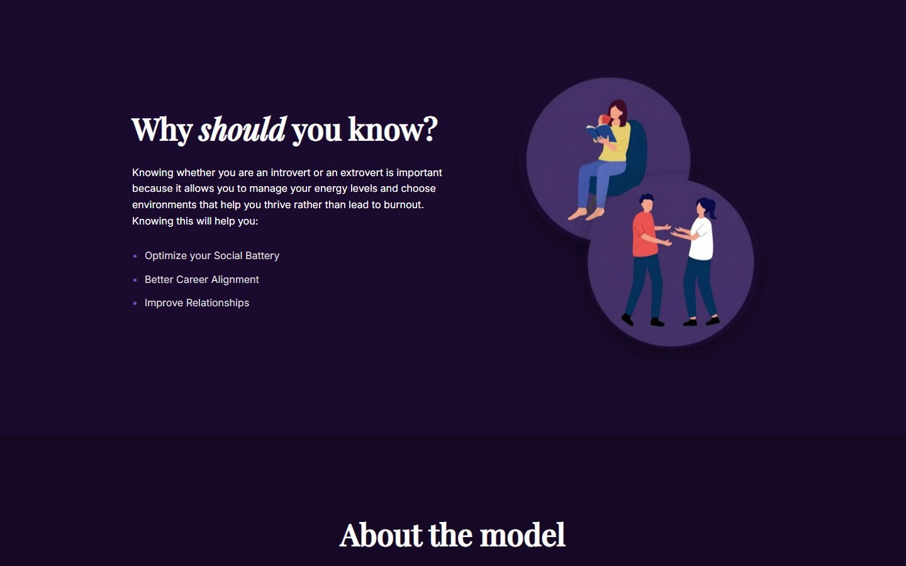
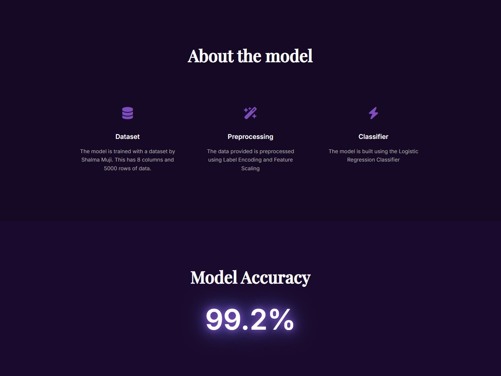
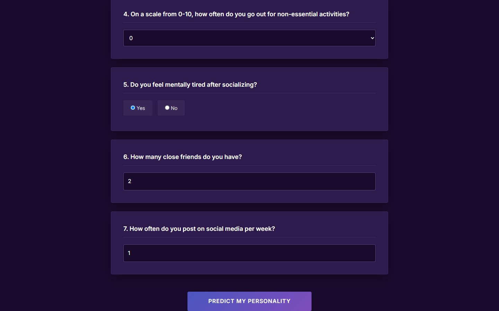
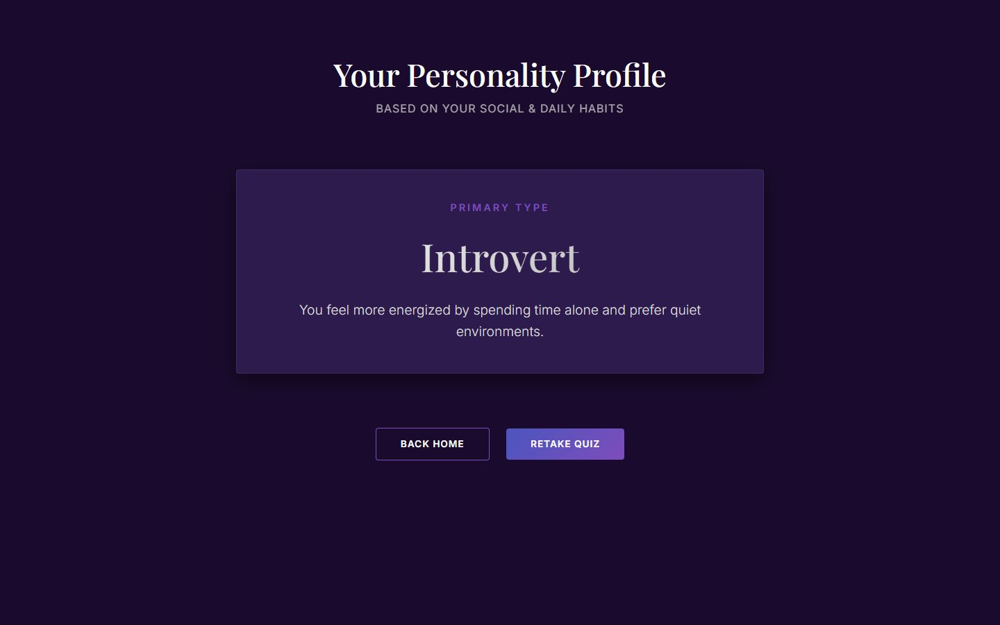

# Personality Predictor

A web app that predicts whether you are an **introvert or an extrovert** from seven questions about your social habits.



## How it works

You answer seven questions: hours spent alone, stage fright, social events attended, how often you go out, whether socializing drains you, number of close friends, and how often you post on social media.

- The five numeric answers are scaled with a `StandardScaler`
- The yes/no answers are label-encoded
- A **Logistic Regression** classifier predicts Introvert or Extrovert

| | |
|---|---|
| Dataset | 5,000 rows, 8 columns (dataset by Shalma Muji) |
| Preprocessing | Label encoding and feature scaling |
| Classifier | Logistic Regression |
| Accuracy | **99.2%** |



## Try it




## Run it locally

Requires Python 3.12 or newer.

```bash
python -m venv .venv
.venv\Scripts\activate        # Windows  (macOS/Linux: source .venv/bin/activate)
pip install -r requirements.txt
python myFlask.py
```

Then open http://127.0.0.1:5000

## Tech stack

Python · Flask · scikit-learn · NumPy · HTML/CSS

## Author

**Sabrina Chavez** · B.S. Computer Science (Data Science and Analytics), Mapúa Malayan Colleges Laguna
